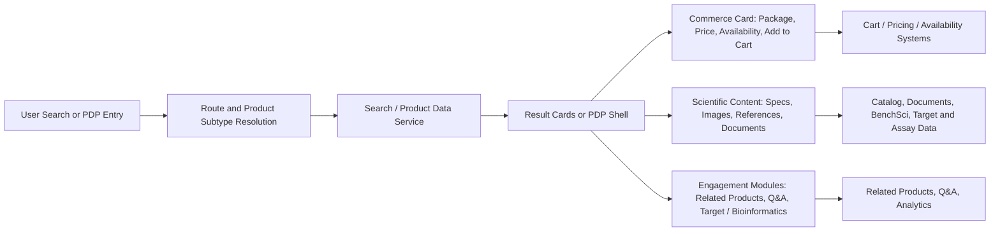
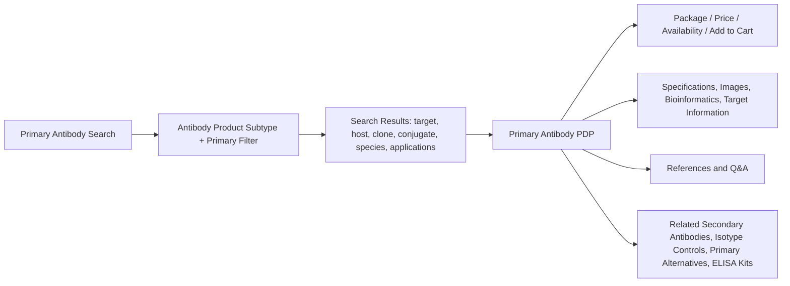
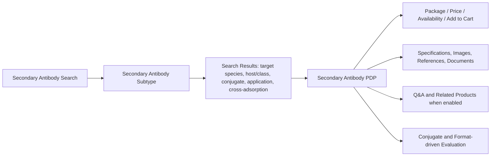
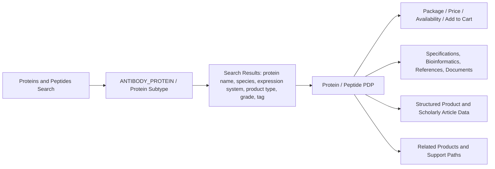
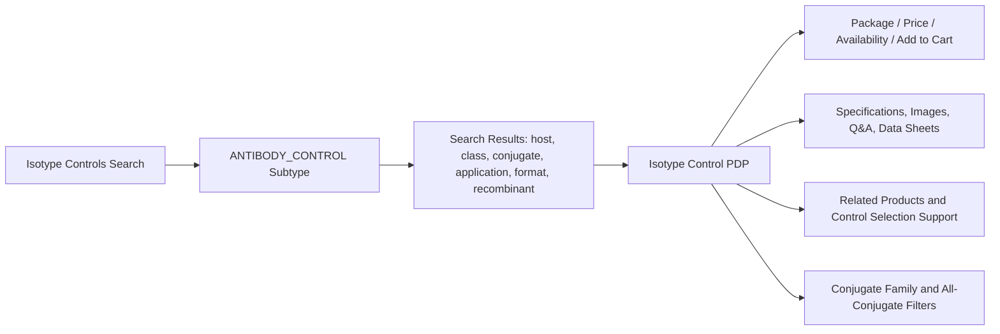
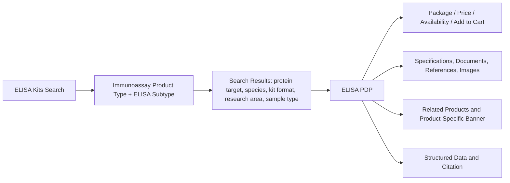
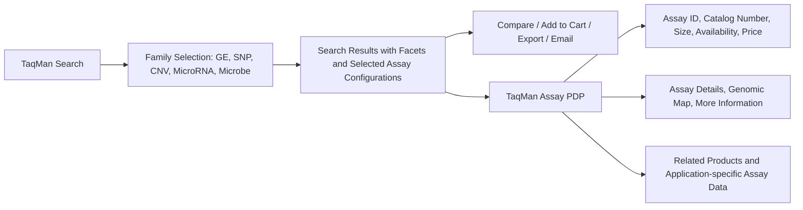

# Product Requirements Document

## Antibody Product Subtypes and TaqMan Assays

| Field | Value |
|---|---|
| Product scope | Primary Antibody, Secondary Antibody, Proteins and Peptides, Isotype Controls, ELISA Kits, and TaqMan Assays |
| Prepared for | Business, Product, Commercial, Scientific Content, Support, Compliance, Analytics, and Digital Platform stakeholders |
| Source rules folder | `BusinessRules-Vedas-Search_PDP.zip` |
| Template references | `Business_User_PRD_Genomics_Tools v2.docx`; `Functional PRD - Catalog Admin to Storefront: Products, Entitlements, Pricing, and Access.doc` |
| Repository reference requested | `https://github.com/orgs/thermofisher/teams/de-magellan/repositories` |
| Repository validation status | Pending. GitHub connector returned an expired-token error during generation. |
| Date | 2026-06-01 |
| Status | Draft PRD |

## 1. Product Overview

### Product Name

Antibody Product Subtypes and TaqMan Assays Product Experience.

### Business Owner

Digital Product Owner / Product Management owner for Magellan Search and PDP experiences. Named business owner by subtype to be confirmed.

### Purpose

The product experience enables customers, sales teams, field application scientists, support teams, and business stakeholders to discover, evaluate, compare where supported, and purchase life-science products across antibody-related product subtypes and TaqMan assays. The experience must preserve scientific accuracy, commerce correctness, regional availability, content completeness, and consistent routing across search result pages and product detail pages.

### Product Families in Scope

| Product family | Search route / entry | PDP route / identity | Business role |
|---|---|---|---|
| Primary Antibody | Antibody primary search; `/antibody/primary/query/{keyword}` | Primary antibody PDP under antibody product routes | Core antibody selection by target, host, species reactivity, application, clone, and conjugate. |
| Secondary Antibody | Antibody secondary search; `/antibody/secondary/query/{keyword}` | Secondary antibody PDP under antibody product routes | Detection antibody selection by target species, conjugate, cross-adsorption, host/class, and application. |
| Proteins and Peptides | Popular Product Area: Proteins and Peptides; `/proteins/query/{keyword}` | `/proteins/product/...` | Recombinant proteins, native proteins, and synthetic peptides for assay controls, standards, and research workflows. |
| Isotype Controls | Popular Product Area: Isotype Controls; `/antibody/control/query/{keyword}` | Isotype Control PDP under antibody product routes | Control antibody selection by host, class/isotype, conjugate, format, and application. |
| ELISA Kits | Popular Product Area: ELISA Kits; `/elisa/query/{keyword}` | `/elisa/product/...` | Immunoassay kit discovery by protein target, species, kit format, sample type, instrument, and sensitivity needs. |
| TaqMan Assays | TaqMan search groups for Gene Expression, SNP Genotyping, Copy Number, MicroRNA, and Microbe Detection | TaqMan assay PDPs and genome-database detail pages | Genomic assay discovery, comparison, configuration, ordering, and assay-detail evaluation. |

### Business Problem

These product families share common search, commerce, and PDP expectations, but each family has different scientific identifiers, filters, PDP sections, recommendation rules, and downstream actions. Business teams need a single PRD that expresses the shared platform requirements while preserving subtype-specific differences so engineering, QA, analytics, support, and product owners can test and maintain the experience without flattening important scientific distinctions.

### Goals

- Standardize the cross-family search and PDP experience where the rules are shared.
- Preserve subtype-specific filters, PDP sections, and recommendation logic.
- Ensure package selection, price, availability, lifecycle banners, Add to Cart, and structured data are correct.
- Support scientific product evaluation through specifications, images, references, Bioinformatics, target information, documents, Q&A, related products, and assay details where applicable.
- Provide business analytics for search engagement, product evaluation, commerce conversion, service failures, and content gaps.
- Give support teams a clear operational model for common customer issues across product families.

### Scope

In scope:

- Search entry, keyword handling, result routing, typeahead/suggestions, result counts, filters, selected filters, zero-result behavior, and product cards.
- PDP identity, banner/lifecycle states, commerce card, package selection, price, availability, Add to Cart, documents/data sheets, image/gallery behavior, references, Q&A, related products, and structured data.
- TaqMan search family selection, compare limit, selected assay configurations, assay detail sections, genomic map, More Information, and related products.
- Architecture diagrams, similarities and differences, analytics, risks, operations, acceptance criteria, and release readiness.

Out of scope:

- New scientific assay design algorithms.
- Replacement of pricing, cart, catalog, authentication, document, Q&A, related-products, or availability systems.
- Manual product-data correction outside approved catalog governance.
- New regulatory or diagnostic claims.

## 2. Users and Stakeholders

### Personas

| Persona | Need | Success Outcome |
|---|---|---|
| Research customer | Find products that match target, organism/species, application, format, assay type, or target identifier. | Can select a product confidently and purchase or share it. |
| Sales / Commercial user | Recommend products and related products to customers. | Can explain product fit, price state, availability, and alternatives. |
| Field Application Scientist | Validate scientific fit for assay workflow, target biology, application, or genomic context. | Can review specifications, assay details, target information, references, and relevant controls. |
| Customer Support | Resolve search, PDP, price, availability, discontinued/replacement, Q&A, and related-product issues. | Can reproduce behavior using product subtype, route, SKU, package, and user context. |
| Product Manager | Monitor engagement, conversion, content completeness, and product-family gaps. | Can identify zero-result terms, high-demand targets, missing specs, and commerce friction. |
| Scientific Content Owner | Maintain product descriptions, specifications, references, documents, target information, and assay metadata. | Content appears accurately and only when values exist. |
| Compliance / Legal | Ensure disclaimers, lifecycle messaging, research-use wording, and claim-sensitive text are correct. | Required notices and restrictions are displayed consistently. |
| Engineering / QA | Build and test search/PDP behavior across shared and subtype-specific rules. | Has clear acceptance criteria by product family. |
| Analytics / Operations | Monitor product engagement, failures, latency, and support drivers. | Can report on actionable signals by subtype and SKU/assay ID. |

### Decision Makers

- Magellan Search/PDP product owner.
- Business owners for Antibodies, Immunoassays/ELISA, Proteins and Peptides, and TaqMan assays.
- Commercial operations leadership.
- Support operations leadership.
- Digital platform engineering leadership.
- Compliance/legal stakeholders.
- Analytics and data governance owner.

## 3. Architecture

### Shared Business Architecture

All product families use a common discovery-to-commerce model:

### Shared Data and Integration Layers

| Layer | Role |
|---|---|
| Route and product subtype mapping | Determines whether the experience is primary antibody, secondary antibody, protein/peptide, isotype control, ELISA, or TaqMan. |
| Search service / index | Returns matching products, counts, facets, spell-check/suggestions, wildcard browse, and zero-result states. |
| PDP product service | Provides product identity, selected package, specifications, content sections, and structured-data fields. |
| Pricing service | Supplies price, user price, currency, pricing action, orderability, and fallback states. |
| Availability service | Supplies inventory, Made to Order / Inventoried state, estimates, and region/dealer-specific details. |
| Cart service | Receives selected SKU/catalog number, quantity, product context, and assay ID where applicable. |
| Documents/data sheet service | Supplies product-specific documents and data sheets. |
| Related products service | Supplies recommendations based on subtype-specific matching rules. |
| Q&A service | Supplies question counts, matched questions, filters, paging, and safe empty states. |
| Media/reference providers | Supply product images, BenchSci figures, publication cards, and reference tables. |
| Analytics | Captures search, filter, PDP, commerce, content, recommendation, Q&A, export/email, compare, and error events. |

### Product-Specific Architecture Diagrams

#### Primary Antibody Architecture

#### Secondary Antibody Architecture

#### Proteins and Peptides Architecture

#### Isotype Controls Architecture

#### ELISA Kits Architecture

#### TaqMan Assays Architecture

## 4. Similarities Across Product Subtypes

| Similarity | Applies To | Requirement Implication |
|---|---|---|
| Product subtype controls routing and modules | All families | Search, PDP, filters, commerce, analytics, Q&A, and related-products behavior must receive the correct subtype. |
| Keyword search supports wildcard browse | Search families | `*` must behave as browse/search coverage, not a literal catalog-number lookup. |
| Keyword input length is constrained | Antibody, Proteins/Peptides, ELISA, Isotype Controls | Search input must respect the configured 250-character limit where rules specify it. |
| Search results are subtype-restricted | All search families | Result cards must not mix unrelated product subtypes. |
| Filters are generated from current result set | Search families | Facet counts must update when filters are applied or removed. |
| Zero-result handling must avoid stale products | Search families | Previous result cards must not remain visible after no-result search. |
| PDP uses selected package as commerce source | Antibody, Proteins/Peptides, Isotype Controls, ELISA | Package selection drives catalog number, SKU/web ID, price, availability, data sheet, and banner context. |
| Lifecycle banners affect purchase path | Antibody, Proteins/Peptides, Isotype Controls, ELISA | Long-term unavailable and discontinued products suppress normal purchase path and show configured messaging. |
| Structured data omits invalid offers | Antibody, Proteins/Peptides, Isotype Controls, ELISA | Discontinued, unavailable, not-orderable, no-price, or no-availability states must suppress offer data. |
| Price failures must fail safely | Commerce-enabled families | Stale prices must not remain visible; fallback price prompts or unavailable states must appear. |
| Add to Cart depends on orderability | Commerce-enabled families and TaqMan | Add to Cart must use selected SKU/catalog configuration and be hidden/disabled when not orderable. |
| Analytics must track discovery and commerce | All families | Search, filter, PDP, price, availability, Add to Cart, related products, content engagement, and errors must be measured. |

## 5. Differences Across Product Subtypes

| Area | Primary Antibody | Secondary Antibody | Proteins and Peptides | Isotype Controls | ELISA Kits | TaqMan Assays |
|---|---|---|---|---|---|---|
| Primary selection model | Target, host, clone, clonality, species reactivity, application, conjugate | Target species/class, conjugate, cross-adsorption, host/class, application | Protein name, species, expression system, product type, grade, tag, activity | Host, class/isotype, conjugate, application, format, target class | Protein target, species, kit format, research area, sample type, instrument, sensitivity | Assay family, assay ID, gene/SNP/CNV/miRNA/microbe context, assay type, size/dye configuration |
| Search route | `/antibody/primary/query/{keyword}` | `/antibody/secondary/query/{keyword}` | `/proteins/query/{keyword}` | `/antibody/control/query/{keyword}` | `/elisa/query/{keyword}` | TaqMan search route with family grouping |
| Typeahead | Primary antibody typeahead; max 15 suggestions | Legacy typeahead when used; max 15 suggestions | Product-area typeahead using PRANT-filtered source | No product-area typeahead unless configured | ELISA typeahead and new typeahead may apply | Family search suggestions and wrong-application behavior |
| Page size from rules | 50 | 50 | 100 | 50 | 50 | Product-family dependent |
| Related products | Secondary antibodies, isotype controls, alternatives, ELISA kits, matched pairs, application-level recommendations | Related products when enabled | Related products/support paths | Related products/control support | Related products and product-category links | Master mixes, arrays, assay-related products by family |
| Deep scientific sections | Bioinformatics, Target Information, References, Q&A | References, Q&A if enabled, product specs | Bioinformatics, references, documents, scholarly article data | Q&A, specs, related products | References, documents, product specs | Genomic Map, Assay Details, More Information |
| Compare | Not a primary rule in attached antibody docs | Not a primary rule in attached secondary docs | Not a primary rule in attached protein docs | Not a primary rule in attached control docs | Not a primary rule in attached ELISA docs | Search rows support compare up to 3 products |
| Ordering identifier | Selected package SKU/web ID | Selected package SKU/web ID | Selected package SKU/web ID | Selected package SKU/web ID | Selected package SKU/web ID | Selected catalog number plus assay ID |

## 6. Core Features and Requirements

### 6.1 Shared Search Requirements

| ID | Requirement | Acceptance Criteria |
|---|---|---|
| SRCH-001 | Each search entry must route to the correct product-family URL. | Primary, Secondary, Isotype, Proteins/Peptides, ELISA, and TaqMan searches land on the correct query/result route. |
| SRCH-002 | Search must use the correct product subtype context. | Result cards, filters, Q&A enablement, related products, commerce, and analytics receive the correct subtype. |
| SRCH-003 | Wildcard searches must act as browse requests where specified. | `*` returns broad product-family coverage rather than being treated as a literal catalog number. |
| SRCH-004 | Result cards must be restricted to the selected product family. | Search results do not mix unrelated product families. |
| SRCH-005 | Filter facets must be generated from the current result set. | Filter counts update after apply/remove and selected filters remain removable. |
| SRCH-006 | Zero-result behavior must show configured product-family messaging. | No stale result cards remain after a no-result response. |
| SRCH-007 | Search result count text must match the filtered result set. | Count shown to the user equals current search service response. |
| SRCH-008 | Keep-my-filters and Solr re-query behavior must apply only when the subtype is enabled in configuration. | Enabled subtypes preserve filters and participate in re-query; disabled subtypes do not. |

### 6.2 Search Requirements by Product Family

| Product family | Search-specific requirements |
|---|---|
| Primary Antibody | Search uses primary antibody target type; typeahead is limited to antibody products and primary filter; suggestions are deduplicated and trademark markers removed; suggested searches include `5E2D7`, `p53`, and `RL90`; default sort is Relevance; page size is 50. |
| Secondary Antibody | Search uses secondary antibody target type and secondary query path; legacy typeahead filters to antibody products and secondary filter; suggested searches include `Qdot 585`, `Alexa Fluor 594`, and `HRP`; page size is 50; newer filters apply when enabled. |
| Proteins and Peptides | Search entry is Popular Product Area `Proteins & Peptides`; route is `/proteins/query/{keyword}`; subtype context is `ANTIBODY_PROTEIN`; page size is 100; filters may include Protein Name, Species, Expression System, Product Type, Application, Product Grade, Tag, New, Activity, and Promotion. |
| Isotype Controls | Search entry is Popular Product Area `Isotype Controls`; route is `/antibody/control/query/{keyword}`; subtype is `ANTIBODY_CONTROL`; page size is 50; filters include Host, Clonality/Class, Conjugate, Application, Format, Target Class, Recombinant, and conjugate-family grouping where available. |
| ELISA Kits | Search entry is Popular Product Area `ELISA Kits`; route is `/elisa/query/{keyword}`; subtype is ELISA; page size is 50; filters may include Protein Target, Species, Kit Format, Research Area, Sample Type, Instrument, High Sensitivity, and New. |
| TaqMan Assays | Blank search is wildcard; unsupported characters are removed; results are grouped into Gene Expression, SNP Genotyping, Copy Number, MicroRNA, and Microbe Detection; wrong-application and suggested-keyword behavior must be shown where applicable. |

### 6.3 Shared PDP Commerce Requirements

| ID | Requirement | Acceptance Criteria |
|---|---|---|
| PDP-001 | PDP must render product title and selected catalog number from product/package data. | Selected package drives catalog number and display context. |
| PDP-002 | Multi-package products must allow package selection. | Changing package updates product size, SKU/web ID, pricing, availability, data sheet, and banner context. |
| PDP-003 | Long-term unavailable products must not expose normal purchase path. | Banner and commerce card show configured alternate/contact behavior. |
| PDP-004 | Discontinued products must not expose normal purchase path unless family-specific rules allow constrained ordering. | Discontinued banner and orderability state are correct. |
| PDP-005 | Pricing requests must use eligible product/package SKUs and respect batching limits. | Valid prices populate price/user price/currency; failures remove stale price and show fallback. |
| PDP-006 | Add to Cart must use selected SKU or catalog number and selected quantity. | Cart payload reflects the selected product/package/assay configuration. |
| PDP-007 | Structured offer data must be omitted when offer conditions are invalid. | Invalid offers do not appear for discontinued, long-term unavailable, not orderable, no final price, or no availability states. |

### 6.4 PDP Requirements by Product Family

| Product family | PDP-specific requirements |
|---|---|
| Primary Antibody | Must support package banner changes, product specs, tested applications/dilutions, Bioinformatics, Target Information, References, BenchSci images, Q&A, and related products including secondary antibodies, isotype controls, alternatives, ELISA kits, matched antibody pairs, and application-level recommendations. |
| Secondary Antibody | Must identify records as Secondary Antibody only when source row type is Secondary Antibody; package banner may promote Alexa Fluor Plus; Q&A and related products apply only when enabled for secondary subtype; product data sheets use secondary subtype. |
| Proteins and Peptides | Must identify product category as Protein and subtype as Protein / `antibody_protein`; PDP route uses `/proteins/product/...`; sample package sizes include 10 ug, 50 ug, 100 ug, 250 ug, 500 ug, and 1 mg; scholarly article structured data may be generated when enabled. |
| Isotype Controls | Must identify product as antibody subtype `antibody_control` / Isotype Control; sample packages include 50 ug, 100 ug, and 500 ug; modules must receive subtype consistently for commerce, data sheets, image gallery, related products, Q&A, technical support, and analytics. |
| ELISA Kits | Must identify product category as ELISA, product type as immunoassay, and subtype ELISA; PDP route uses `/elisa/product/...`; sample package options include 96 Tests and 5 x 96 Tests; product-specific banner may promote related ProQuantum kit. |
| TaqMan Assays | Product pages must carry assay ID and selected catalog number; selected size or dye-size determines catalog number and availability; pages may show Genomic Map, Assay Details, More Information, and Related Products when data is available. |

### 6.5 TaqMan Family Requirements

| Family | Requirements |
|---|---|
| Gene Expression and Microbe Detection | Show gene symbol, gene name, aliases, chromosome location, species, species-specific ID, assay ID, best coverage, size options, availability, catalog number, commerce actions, mapping information, set membership, and configured related products. |
| SNP Genotyping | Show SNP ID, gene, gene name, set membership, chromosome location, polymorphism, context sequence, assay ID, size options, availability, catalog number, commerce actions, species, dbSNP submissions, phenotype, PubMed literature links, allele nomenclature, and minor allele frequency where available. |
| Copy Number | Show other CNV assays for same gene, gene symbol, reference genome location, cytoband, assay ID, size options, availability, catalog number, commerce actions, Target Gene Details, transcript accession, exon location, assay transcript location, and protein ID where available. |
| MicroRNA | Support Advanced miRNA, Classic MicroRNA, Pri-miRNA, and miRNA Arrays; preserve subtype-specific result rows and product actions. |
| Microbe Detection / ABR | Include Microbe Detection and Antibiotic Resistance assays in Microbe Detection counts and result behavior. |

### 6.6 Related Products Requirements

| ID | Requirement | Acceptance Criteria |
|---|---|---|
| REL-001 | Primary antibody related products must use subtype-specific matching rules. | Secondary antibody recommendations match host species to target species and target isotype to target class; isotype controls match host/isotype and conjugate where applicable; ELISA recommendations require ELISA application support. |
| REL-002 | Related primary alternatives must exclude the original primary antibody. | Alternatives match target protein and target isotype and prioritize clone, conjugate, and size. |
| REL-003 | Application-level related products must require both application and SKU. | Related products can group by subapplication and filter by application/subapplication. |
| REL-004 | TaqMan assay related products must render only when assay-family related-product data exists. | Master mixes, cDNA synthesis kits, genotyping master mixes, arrays, or other assay-related products appear according to family configuration. |

### 6.7 Q&A, References, Documents, and Scientific Content

| ID | Requirement | Acceptance Criteria |
|---|---|---|
| CNT-001 | Q&A must generate subtype-appropriate keywords and fail safely. | Failed counts return zero and failed searches return empty result sets. |
| CNT-002 | Primary antibody Q&A matching must include exact SKU and keyword filters. | Host, clonality, protein target, conjugate, clone, brand, target species, format, recombinant, product subtype, and applications are included when present. |
| CNT-003 | References must show available cards and support sorting/expansion where defined. | BenchSci cards show image/icon/disclaimer; non-BenchSci cards show source, title, year, species, dilution, description, and authors where available. |
| CNT-004 | Bioinformatics and Target Information must appear only when visible data exists. | Section navigation includes visible sections only. |
| CNT-005 | Documents/data sheets must refresh when selected package changes. | User receives package-relevant data sheet/document context. |

## 7. Data and Analytics

### Business KPIs

| KPI | Definition | Business Use |
|---|---|---|
| Search volume by family | Searches by Primary, Secondary, Proteins/Peptides, Isotype, ELISA, and TaqMan family. | Understand demand and adoption. |
| Search-to-result rate | Searches returning at least one product. | Identify search quality and catalog coverage. |
| Zero-result rate | Searches returning no products. | Identify synonym gaps, catalog gaps, or wrong-family behavior. |
| Filter usage | Facets applied by product family. | Understand user decision criteria. |
| Search-to-PDP rate | Result clicks leading to PDP. | Measure discovery effectiveness. |
| PDP content engagement | Views of specs, Bioinformatics, References, Documents, Q&A, Assay Details, Genomic Map, More Information. | Identify high-value content and content gaps. |
| Related-product click-through | Related product impressions and clicks. | Measure recommendation usefulness. |
| Price availability rate | Products with valid price, View price in cart, Contact Us, or Price not available. | Track commerce friction. |
| Availability engagement | Availability checks and estimated availability views. | Track purchase confidence. |
| Add-to-cart rate | Orderable products added to cart. | Measure conversion. |
| TaqMan compare usage | Compare selections and compare limit warnings. | Measure assay evaluation behavior. |
| Q&A usage | Q&A count, search, filter, and question views. | Measure support self-service. |
| Error rate by module | Pricing, availability, search, related products, Q&A, references, documents, cart. | Prioritize reliability improvements. |

### Required Reporting Events

- Product family selected.
- Keyword searched.
- Wildcard browse submitted.
- Suggested keyword shown and selected.
- Wrong-application state shown for TaqMan.
- Results loaded.
- Zero results shown.
- Filter applied and removed.
- Product card clicked.
- PDP opened.
- Package or assay configuration changed.
- Product banner shown, closed, and replacement clicked.
- Price loaded, failed, or unavailable.
- Check price clicked.
- Availability requested and shown.
- Add to Cart clicked, succeeded, or failed.
- Compare selected, compare opened, and compare limit warning shown.
- Export/email clicked where supported.
- Specifications viewed.
- Bioinformatics viewed.
- Target Information expanded/collapsed.
- References loaded, sorted, expanded/collapsed.
- Related product viewed and clicked.
- Q&A count loaded, search performed, filter applied, result opened, or error returned.
- Document/data sheet clicked.
- Genomic Map, Assay Details, and More Information viewed for TaqMan.

### Analytics Dimensions

Product family, product subtype, keyword, normalized keyword, selected filters, species, target/gene/protein, host, clone, clonality/class, conjugate, application, kit format, sample type, expression system, assay family, assay ID, catalog number, selected package size, country, language, login state, result count, selected product count, price state, availability state, lifecycle state, and cart outcome.

## 8. Risks and Constraints

| Risk / Constraint | Impact | Mitigation |
|---|---|---|
| GitHub repository access is unavailable. | Requirements are rule-document-derived, not source-confirmed. | Restore GitHub access and map each PRD requirement to source files/services before final sign-off. |
| Product subtype mapping drifts between UI and backend. | Wrong route, filters, commerce behavior, Q&A, or related products may appear. | Maintain subtype contract tests and a shared mapping register. |
| Search index data is incomplete or stale. | Products may be missing or filters/counts may be wrong. | Add index freshness monitoring and data-quality dashboards. |
| Pricing or availability failures. | Users cannot purchase confidently. | Fail safely, remove stale values, and monitor service errors by subtype/SKU. |
| Package selection does not refresh dependent content. | Price, availability, data sheet, banner, or SKU could be wrong. | Add automated tests for package-change dependencies. |
| Related-product logic recommends weak matches. | Users may select inappropriate controls, secondary antibodies, kits, or assay accessories. | Use curated validation sets and track related-product click/conversion. |
| Q&A overmatching or service errors. | Irrelevant questions or empty Q&A results reduce trust. | Monitor keyword quality, exact SKU matching, and error rates. |
| Compliance-sensitive product claims. | Regulatory or legal risk. | Require compliance review for product-use, research-use, diagnostic-use, and lifecycle messaging. |
| TaqMan family routing ambiguity. | Users may search in the wrong family or miss valid assay results. | Preserve wrong-application and suggested-keyword behavior and track frequency. |
| Legacy route dependencies. | CNV, miRNA, or antibody route changes could break user journeys. | Monitor destination health and add route-level tests. |

## 9. Operations and Support

### Monitoring Requirements

- Search API latency and error rate by product family.
- Result count anomalies and zero-result spikes by family.
- Filter/facet service failures.
- Typeahead/suggestion failures.
- PDP load success and section visibility by subtype.
- Pricing service latency, error rate, and pricing-action distribution.
- Availability request success, estimate pending rate, and dealer availability errors.
- Cart add success/failure by SKU/catalog number and subtype.
- Package-change failures.
- Product banner display frequency by lifecycle state.
- Related-products response empty/error rate and click-through.
- Q&A count/search error rate and empty response rate.
- Reference/document/media load failures.
- TaqMan compare limit warnings and selected configuration mismatches.

### Common Support Scenarios

| Scenario | Expected Support Handling |
|---|---|
| User cannot find a product. | Check product family, keyword, subtype, wildcard behavior, filter state, and zero-result message. |
| Search result count seems wrong. | Validate current filters, subtype restriction, Solr re-query behavior, and indexed data freshness. |
| Product cannot be added to cart. | Check selected package, orderability, lifecycle state, pricing action, availability, quantity, and country/login context. |
| Price is missing or stale. | Check pricing response, fallback state, selected SKU, and user context. |
| Availability is unavailable or Pending. | Check country enablement, selected SKU, quantity, dealer context, and estimated availability rules. |
| Banner conflicts with product action. | Check selected package long-term unavailable/discontinued/replacement state and banner message. |
| Related product appears incorrect. | Validate subtype-specific matching fields and priority rules. |
| Q&A results are missing or irrelevant. | Check exact SKU, generated keywords, filters, page/limit, and service error state. |
| TaqMan compare or selected configuration is wrong. | Check assay ID, selected catalog number, size/dye-size configuration, and compare limit. |
| References/images/documents missing. | Check content provider, product media count, BenchSci/reference rules, and data sheet package context. |

### Business Admin Needs

- Maintain product family labels and route ownership.
- Review subtype and product-type mappings.
- Review filter label consistency and configured facet order.
- Review lifecycle, replacement, and product-specific banner copy.
- Review related-product matching quality by subtype.
- Review Q&A keyword quality and support-deflection value.
- Review content completeness for specifications, documents, references, Bioinformatics, and assay details.
- Review analytics dashboards and support escalations.
- Coordinate compliance review for product-use and diagnostic-use notices.

## 10. Acceptance Test Scenarios

| ID | Scenario | Expected Result |
|---|---|---|
| AT-001 | Submit wildcard search for each product family. | Product-family browse results load and are restricted to the selected family. |
| AT-002 | Apply and remove filters on each search page. | Counts and selected-filter region update correctly. |
| AT-003 | Search a term with no results. | Configured zero-result behavior appears and stale cards are removed. |
| AT-004 | Open a multi-package antibody, protein, isotype, or ELISA PDP. | Package selector appears and changing package refreshes price, availability, data sheet, and banner context. |
| AT-005 | Open a discontinued or long-term unavailable product. | Normal purchase path is suppressed and correct banner/support path appears. |
| AT-006 | Trigger pricing failure or no-price response. | Stale price is removed and fallback prompt/message appears. |
| AT-007 | Add an orderable product to cart. | Cart payload uses selected SKU/catalog number, quantity, and product context. |
| AT-008 | Load primary antibody with Bioinformatics and Target Information. | Visible sections appear and navigation includes only visible sections. |
| AT-009 | Load primary antibody references. | BenchSci and non-BenchSci cards display correct fields and sort/expand behavior works. |
| AT-010 | Validate primary antibody related products. | Secondary, isotype, alternative, ELISA, matched pair, and application-level recommendations follow matching rules. |
| AT-011 | Validate isotype control all-conjugate filters. | Parent conjugate groups appear only when child families have results. |
| AT-012 | Validate ELISA search filters. | Protein Target, Species, Kit Format, Research Area, Sample Type, Instrument, High Sensitivity, and New appear when data exists. |
| AT-013 | Validate Proteins and Peptides search filters. | Protein Name, Species, Expression System, Product Type, Application, Product Grade, Tag, New, Activity, and Promotion appear when data exists. |
| AT-014 | Submit TaqMan search with unsupported characters. | Unsupported characters are removed and search is submitted with allowed characters. |
| AT-015 | Select more than three TaqMan products for compare. | User sees warning that only three items can be compared. |
| AT-016 | Change TaqMan assay size or dye-size. | Catalog number, selected size, availability, price, and Add to Cart context update. |
| AT-017 | Force Q&A service error. | Count returns zero or result set returns empty without breaking PDP. |

## 11. Release Readiness Checklist

| Area | Readiness Requirement |
|---|---|
| Source traceability | GitHub access restored and requirements mapped to de-magellan repositories. |
| Rule coverage | All source rule docs from the ZIP are represented in PRD scope. |
| Search routing | Routes validated for Primary, Secondary, Proteins/Peptides, Isotype, ELISA, and TaqMan. |
| Filters | Family-specific filters validated by product owners. |
| PDP identity | Product type, subtype, category, title, catalog number, and breadcrumb validated. |
| Commerce | Package, price, availability, quantity, Add to Cart, and fallback states tested. |
| Lifecycle banners | Long-term unavailable, discontinued, replacement, and custom banner states tested. |
| Related products | Recommendation quality tested for primary antibody and TaqMan; enabled-state behavior tested for other families. |
| Q&A | Enabled subtype behavior, keyword matching, sorting, paging, and error handling tested. |
| Scientific content | Specs, images, references, Bioinformatics, target information, documents, assay details, genomic map, and More Information tested where applicable. |
| Analytics | Required events and dimensions validated end to end. |
| Operations | Dashboards and alerts defined by service and subtype. |
| Support | Support playbook and escalation owners documented. |
| Compliance | Research-use, diagnostic-use, resale, lifecycle, and claim-sensitive copy reviewed. |

## 12. Open Questions

- Which exact de-magellan repositories are authoritative for each module: search UI, PDP UI, product service, pricing, availability, related products, Q&A, documents, and analytics?
- Should antibody product subtypes and TaqMan assays remain in one product-level PRD, or should this document become a parent PRD with child PRDs by family?
- Which product families should support compare in future releases beyond TaqMan?
- Which analytics platform is the source of truth for search/PDP events?
- What are the target SLAs for search, pricing, availability, related products, Q&A, references, documents, and TaqMan assay detail services?
- Should support users have a diagnostic mode showing product subtype, selected SKU, pricing action, availability response, Q&A keywords, and related-product match inputs?
- Who owns review and correction of related-product quality across Primary, Secondary, Isotype, ELISA, and TaqMan?
- Should TaqMan export/email requirements be added to this PRD if this scope expands from PDP/search to full result-list actions?

## 13. Source Rule Documents Used

| Rule document | Scope used |
|---|---|
| `Primary_Antibody_Search_Business_Rules.docx` | Primary antibody search entry, typeahead, result count, filters, keyword handling, and search behavior. |
| `Primary_Antibody_Product_Series_Business_Rules.docx` | Primary antibody PDP, commerce, specifications, Bioinformatics, Target Information, References, Related Products, and Q&A. |
| `Secondary_Antibody_Search_Business_Rules.docx` | Secondary antibody search entry, legacy typeahead, results, keyword handling, and filter behavior. |
| `Secondary_Antibody_Product_Series_Business_Rules.docx` | Secondary antibody PDP identity, banner, commerce, Q&A/related-products enablement, and product details. |
| `Proteins_Peptides_Search_Business_Rules.docx` | Proteins and Peptides search routing, page size, typeahead, filters, and zero-result behavior. |
| `Proteins_Peptides_Product_Series_Business_Rules.docx` | Protein/peptide PDP identity, commerce, structured data, packages, scholarly article data, and content modules. |
| `Isotype_Controls_Search_Business_Rules.docx` | Isotype Controls search route, subtype, filters, typeahead limitations, and result behavior. |
| `Isotype_Controls_Product_Series_Business_Rules.docx` | Isotype Controls PDP identity, commerce, package options, Q&A, related products, and structured data. |
| `ELISA_Search_Business_Rules.docx` | ELISA search entry, route, typeahead, filters, result behavior, metadata, and zero-result handling. |
| `ELISA_Product_Series_Business_Rules.docx` | ELISA PDP identity, commerce, banner, package options, structured data, references, documents, and related products. |
| `TaqMan_Assays_Search_Business_Rules.docx` | TaqMan family selection, wildcard, sanitization, family grouping, compare, selected configuration, and result row sections. |
| `TaqMan_Assays_Product_Series_Business_Rules.docx` | TaqMan PDP commerce, assay ID/catalog rules, Genomic Map, Assay Details, More Information, and family-specific assay details. |

## 14. Repository Validation Note

The PRD references the de-magellan team repositories requested by the user. During generation, GitHub access failed with an expired-token error, so repository-level validation could not be completed. This PRD is therefore grounded in the attached business-rule documents and template structure. Final approval should include a follow-up source traceability pass against the relevant repositories after GitHub access is restored.
