# Product Requirements Document

## Antibody Product Subtypes: Primary Antibody, Secondary Antibody, Proteins and Peptides, Isotype Controls, and ELISA Kits

| Field | Value |
|---|---|
| Product scope | Primary Antibody, Secondary Antibody, Proteins and Peptides, Isotype Controls, ELISA Kits |
| Prepared for | Business, Product, Commercial, Scientific Content, Support, Compliance, Analytics, and Digital Platform stakeholders |
| Source rules folder | `BusinessRules-Vedas-Search_PDP_NoTaqman.zip` |
| Template references | `Business_User_PRD_Genomics_Tools v2.docx`; `Functional PRD - Catalog Admin to Storefront: Products, Entitlements, Pricing, and Access.doc` |
| Repository reference requested | `https://github.com/orgs/thermofisher/teams/de-magellan/repositories` |
| Repository validation status | Partially validated. Accessible Magellan repository evidence can be used, but the exact `de-magellan` team repository membership list is not exposed from the team URL in this environment. Final repository completeness should be confirmed by the team. |
| Date | 2026-06-05 |
| Status | Draft PRD |

## Table of Contents

The Word document includes an automatic table of contents with page numbers at the beginning of the PRD. Page numbers are generated by Word from the document headings.

## 1. Product Overview

### Name

Antibody Product Subtypes Product Experience.

### Owner

Digital Product Owner / Product Management owner for Magellan Search and PDP experiences. Named business owner by product subtype to be confirmed.

### Purpose

The product experience helps customers and internal teams search for, evaluate, and purchase antibody-related products across Primary Antibody, Secondary Antibody, Proteins and Peptides, Isotype Controls, and ELISA Kits. The experience must preserve the correct product subtype, search route, result filters, product detail content, package selection, pricing, availability, Add to Cart behavior, documents, related products, Q&A behavior, and analytics context for each product family.

### Business Goals

- Make product discovery reliable across antibody-related search entry points.
- Keep product search results restricted to the selected product subtype.
- Present product details, specifications, images, references, documents, related products, and Q&A only when supported by available product data and enabled subtype rules.
- Ensure commerce actions are based on the selected package, selected SKU/web ID, orderability, lifecycle state, country eligibility, and pricing/availability response.
- Reduce customer confusion caused by stale result cards, missing filters, stale prices, incorrect package context, or unavailable product lifecycle states.
- Give business and support teams clear analytics and monitoring signals for search quality, PDP engagement, pricing/availability friction, related-product usage, and content gaps.

### Scope

In scope:

- Search entry, keyword handling, typeahead/suggestions, wildcard browse, result count, filters, sorting, badges, promotions, zero-result behavior, and product-card routing.
- PDP product identity, selected catalog/package behavior, title banners, lifecycle and replacement messaging, commerce card, price, availability, Add to Cart, data sheets, structured data, image gallery, references, Q&A, related products, technical support, and analytics.
- Functional architecture diagrams, data flow diagrams, API/integration capability summary, similarities, differences, workflows, acceptance criteria, KPIs, risks, operations, and support needs.

Out of scope:

- TaqMan assay search and PDP rules.
- New scientific assay-design logic.
- Replacement of search, pricing, availability, cart, catalog, document, image, related-product, Q&A, or analytics systems.
- Manual correction of source catalog data outside approved product-data governance.
- New product claims or diagnostic-use claims.

## 2. Users and Stakeholders

### Personas

| Persona | User Need | Success Outcome |
|---|---|---|
| Research customer | Find products by target, species, host, class, conjugate, application, kit format, protein name, expression system, or sample type. | Can select a suitable product and continue to PDP, price/availability, or cart. |
| Sales / Commercial user | Recommend appropriate products and explain price, availability, lifecycle, and alternatives. | Can identify product fit and customer next steps without manual lookup. |
| Field Application Scientist | Validate scientific fit for applications, targets, controls, kit types, and protein/peptide needs. | Can review specifications, references, documents, Bioinformatics, Target Information, and related products where available. |
| Customer Support | Resolve search, PDP, price, availability, discontinued/replacement, document, Q&A, and related-product questions. | Can reproduce behavior using product subtype, route, SKU, package, user context, and enabled configuration. |
| Product Manager | Monitor adoption, content completeness, conversion, and product-family gaps. | Can identify zero-result terms, missing filters, missing content, lifecycle issues, and commerce friction. |
| Scientific Content Owner | Maintain specifications, references, product descriptions, documents, images, target data, and kit/protein attributes. | Product content appears accurately and empty values are not shown as real content. |
| Compliance / Legal | Review research-use, diagnostic-use, resale, lifecycle, and claim-sensitive messaging. | Required notices and restrictions are consistently displayed. |
| Engineering / QA | Build and test shared and subtype-specific behavior. | Has clear acceptance criteria by product family. |
| Analytics / Operations | Monitor service health, product engagement, and error patterns. | Can report by product subtype, SKU/catalog, country, login state, and module. |

### Decision Makers

- Product owner for antibody search and PDP.
- Business owners for Primary Antibody, Secondary Antibody, Proteins and Peptides, Isotype Controls, and ELISA Kits.
- eCommerce product owner.
- Search/PDP platform owner.
- Commercial operations leadership.
- Customer support leadership.
- Compliance and legal stakeholders.
- Analytics and data governance owner.

## 3. Architecture

### Tech Stack and Functional Components

The rules documents do not name every implementation technology. Reviewed Magellan evidence supports a search and PDP application composed of server-side application code, browser UI modules, Solr-backed search behavior, and configured integrations for commerce, pricing, availability, images, documents, Q&A, references, analytics, and related products. The PRD stays at the functional level where implementation facts are not explicit.

| Component | Functional Role From Rules |
|---|---|
| Product-family search entry | Routes the user to the correct family-specific search page and subtype context. |
| Search result service / search response | Returns matching product records, result counts, result cards, filters, selected filters, zero-result behavior, and sort behavior. |
| Typeahead / suggestion capability | Provides product-area suggestions when configured for the subtype. |
| Solr re-query behavior | Applies only when the relevant subtype is included in the enabled-subtype configuration. |
| Keep-my-filters behavior | Preserves selected filters only when enabled for the relevant subtype. |
| Metadata handler | Applies to ELISA and Proteins and Peptides only when the subtype is enabled. |
| Product detail page shell | Renders title, selected catalog number, product URL route, breadcrumbs/category paths, citation text, and subtype-specific modules. |
| Commerce card | Uses selected package details to determine catalog number, package size, web ID/SKU, orderability, entitlement, price state, lifecycle state, lead time, parent SKU status, and Add to Cart behavior. |
| Pricing API | Called only for eligible products and eligible countries; responses populate price, user price, currency, and visibility; missing/failing data must not leave stale prices visible. |
| Availability lookup | Displays availability and estimates only when enabled and relevant to the selected package/SKU and user context. |
| Add to Cart integration | Submits selected SKU/web ID, quantity, and product identity only when the selected product is orderable and not lifecycle-blocked. |
| Data sheet / document capability | Refreshes document context when selected package changes. |
| Image gallery and structured data | Uses product images or no-image/default placeholders and omits invalid structured offers. |
| Related products capability | Applies only when enabled for the subtype and product data supports related products. |
| Q&A capability | Applies only when Q&A is enabled for the subtype and must fail safely. |
| Analytics | Receives subtype-specific context for search, PDP, commerce, content, related products, Q&A, and errors. |

### Detailed Functional Architecture

The product experience is organized as a set of functional layers. Each layer makes a business decision before the next layer is allowed to render content, submit commerce actions, or report analytics.

| Layer | Business Responsibility | Key Inputs | Business Output |
|---|---|---|---|
| Entry and route resolution | Determines which product family the user is trying to search or view. | Search entry, URL pattern, keyword, product route, product subtype. | Correct family route and subtype context. |
| Search execution | Returns only products that belong to the selected product family. | Product subtype, keyword, country, page position, selected filters, configured page size. | Result set, result count, product cards, zero-result state. |
| Suggestion and typeahead | Shows product-family suggestions only when configured for that subtype. | Search term, subtype, typeahead configuration. | Deduplicated suggestions or no product-area suggestion call. |
| Filter and sort | Lets users narrow current results using subtype-relevant facets. | Current result set, configured facet order, selected filters, country-specific sort rules. | Visible filters, selected filters, updated counts, valid sort options. |
| PDP identity | Establishes what product and subtype the PDP represents. | Product display name, selected package, route, category, subtype, citation fields. | Product title, selected catalog number, breadcrumb/category, citation, structured identity. |
| Banner and lifecycle | Communicates unavailable, discontinued, replacement, and product-specific messages. | Selected package lifecycle, replacement data, package banner message, banner enablement. | Visible banner, replacement/support path, closed-banner state. |
| Commerce card | Determines whether the selected package can be priced, checked for availability, or purchased. | Selected package, SKU/web ID, entitlement, orderability, pricing action, lifecycle, country, login context. | Price state, availability state, Add to Cart, Check Price, Contact Us, Learn Where to Buy, or dealer path. |
| Content modules | Displays scientific and product content only when relevant values exist. | Specifications, documents, images, references, Bioinformatics, Target Information, Q&A, related-product data. | Visible content sections and section navigation. |
| Related products and Q&A | Adds decision support only when enabled and backed by matching data. | Product subtype, selected SKU, product attributes, Q&A enablement, related-products enablement. | Related product lists, Q&A count/results, or safe empty state. |
| Analytics and monitoring | Records what users saw, changed, submitted, or could not complete. | Route, subtype, keyword, filters, selected SKU, price state, availability state, content events, errors. | Reporting events, operational alerts, support diagnostics. |

### Functional Architecture Decision Points

| Decision Point | Trigger | Business Decision | Outcome |
|---|---|---|---|
| Product family selection | User chooses a search entry or opens a product-family route. | The system assigns the matching product subtype context. | Search and PDP behavior use that subtype. |
| Keyword submission | User submits keyword or wildcard. | The system routes to the family-specific query path and applies keyword rules. | Results load for that product family or zero-result behavior appears. |
| Typeahead lookup | User types in a search field. | The system calls product-area typeahead only when configured for that subtype. | Suggestions appear, or no product-area typeahead call is made. |
| Filter application | User selects or removes a filter. | The system recalculates result count and visible facets from current results. | Selected-filter region and result cards update. |
| Package selection | User changes PDP package size. | The selected package becomes the source for SKU/web ID, price, availability, data sheet, and banner. | Commerce and product context refresh for the selected package. |
| Lifecycle evaluation | Selected package is unavailable, discontinued, replaced, or has a banner message. | The system decides whether normal purchase remains available and which message is shown. | Banner and purchase action reflect lifecycle state. |
| Pricing response | Pricing data succeeds, fails, is missing, or marks SKU not orderable. | The system decides whether to show price, fallback prompt, unavailable message, or disabled purchase. | Stale prices are removed and correct price action is shown. |
| Availability response | Availability is requested for selected SKU and quantity. | The system decides whether availability, estimate, Pending, or dealer-specific details can be shown. | Availability details reflect current SKU and user context. |
| Content visibility | PDP modules receive product content values. | The system displays a section only when supported values are present and enabled. | Empty sections are hidden or omitted. |
| Q&A failure | Q&A count or search fails. | The system returns a safe zero or empty result state. | PDP remains usable without broken Q&A. |

### Detailed Search Functional Architecture

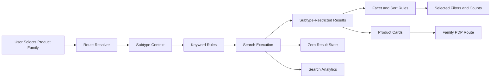

### Detailed PDP Functional Architecture

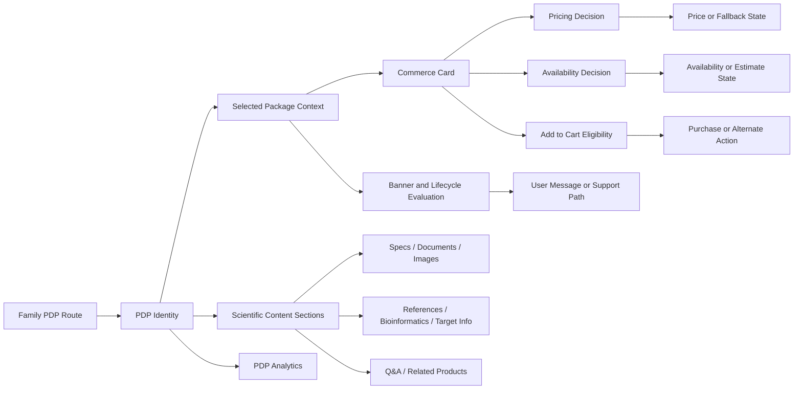

### Detailed Commerce Decision Architecture

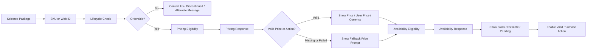

### Functional Module Matrix

| Functional Module | Primary Antibody | Secondary Antibody | Proteins and Peptides | Isotype Controls | ELISA Kits |
|---|---|---|---|---|---|
| Family-specific search route | Yes | Yes | Yes | Yes | Yes |
| Product-area typeahead | Yes | Legacy when used | Yes | No unless configured | Yes |
| Wildcard browse/default keyword | Default wildcard | Default wildcard | Explicit wildcard browse | Explicit wildcard browse | Explicit wildcard browse |
| Result filters from current result set | Yes | Yes | Yes | Yes | Yes |
| Newer filter experience | When enabled | When enabled | When enabled | When enabled | When enabled |
| Metadata handling | Not identified in supplied rules | Not identified in supplied rules | When enabled for subtype | Not identified in supplied rules | When enabled for subtype |
| Image search behavior | Not specified in supplied rules | Not specified in supplied rules | Excluded unless enabled | Not specified in supplied rules | Excluded unless enabled |
| Multi-package commerce | Yes | Yes | Yes | Yes | Yes |
| Lifecycle banner | Yes | Yes | Yes | Yes | Yes |
| Data sheet refresh on package change | Yes | Yes | Yes | Yes | Yes |
| Structured product data | Yes | Yes where product data supports it | Yes | Yes | Yes |
| Structured offer omission | Yes | Yes | Yes | Yes | Yes |
| References | Yes | Yes where available | Yes | Not emphasized in supplied rules | Yes |
| Bioinformatics | Yes | Not identified in supplied rules | Present when content exists | Not identified in supplied rules | Not identified in supplied rules |
| Target Information | Yes | Not identified in supplied rules | Not identified in supplied rules | Not identified in supplied rules | Not identified in supplied rules |
| Q&A | Yes | When enabled | Not identified in supplied rules | Yes | Not identified in supplied rules |
| Related products | Yes, with detailed matching rules | When enabled | When data exists | When data exists | When data exists |

### Functional API and Integration Flow

| API / Integration Capability | Functional Consumer | Business Inputs | Business Output / Decision |
|---|---|---|---|
| Search query route | Search page | Product family, keyword, subtype, country, filters, page size. | Product-family result set, count, facets, and zero-result state. |
| Typeahead / suggestions | Search box | Search text, subtype, typeahead configuration. | Suggestions or no call when not configured. |
| Product detail lookup | PDP shell | Product URL, product identity, selected catalog/package. | PDP identity, selected package, category/breadcrumb, specifications, and module data. |
| Package selector | Commerce card | Available package sizes and selected package. | Selected SKU/web ID and refreshed commerce context. |
| Pricing API | Commerce card | Eligible SKU/web ID set, country, product context. | Price, user price, currency, orderability, fallback prompt, or unavailable state. |
| Availability lookup | Commerce card | Selected SKU, quantity, country, login/dealer context. | Stock state, estimate, Pending state, or dealer-specific availability. |
| Cart integration | Commerce card | Selected SKU/web ID, product identity, quantity. | Cart success or failure. |
| Data sheet / document lookup | PDP content | Product subtype and selected package. | Correct package-specific data sheet or document link. |
| Image / structured data source | PDP content and schema | Product images, default image configuration, product specifications. | Image display and structured product data with invalid offers omitted. |
| Related products lookup | PDP content | Product subtype, selected SKU, product attributes, enablement. | Related products or empty state. |
| Q&A lookup | PDP content | Selected SKU, subtype, generated keywords, paging/filter inputs. | Q&A count, result set, zero count, or empty result. |
| Analytics event publishing | Search/PDP/commerce/content modules | Product family, subtype, route, keyword, filters, selected SKU, action state. | Business reporting and operational diagnostics. |

### Functional Data Ownership

| Data Area | Source Of Business Truth In PRD Terms | Used By |
|---|---|---|
| Product subtype | Product-family route and product record classification. | Search, PDP modules, Q&A, related products, analytics. |
| Product identity | Product display name, category, product route, selected package. | PDP title, breadcrumb, citation, structured data. |
| Selected package | Package selector and selected catalog/package record. | Commerce card, price, availability, banner, data sheet. |
| Price state | Pricing response for eligible SKU/country context. | Price display, Add to Cart gating, fallback prompts. |
| Availability state | Availability response for selected SKU/quantity/context. | Stock display, estimate, Pending state, dealer availability. |
| Lifecycle state | Product/package long-term unavailable, discontinued, replacement, and banner data. | Banner messages, normal purchase path, support path. |
| Search filters | Current search result set and configured filter behavior. | Visible filters, selected filters, result counts. |
| Content sections | Product specification, image, document, reference, Bioinformatics, target, related-product, and Q&A data. | PDP section visibility and navigation. |
| Analytics dimensions | Route, subtype, selected package, price state, availability state, content engagement, action outcome. | KPI reporting and support diagnostics. |

### Shared Functional Architecture

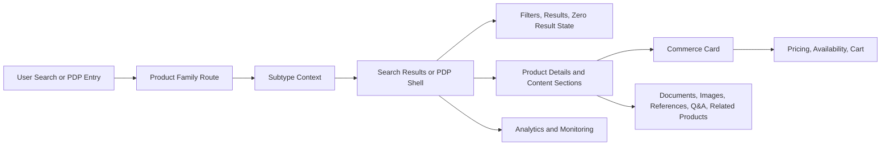

### Shared Data Flow

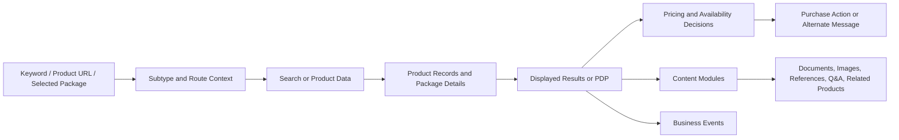

### Primary Antibody Functional Architecture

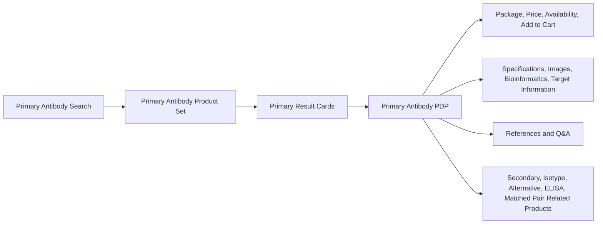

### Primary Antibody Data Flow

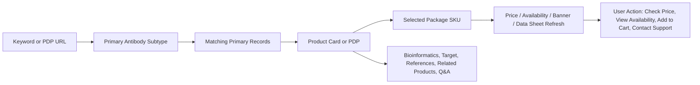

### Secondary Antibody Functional Architecture

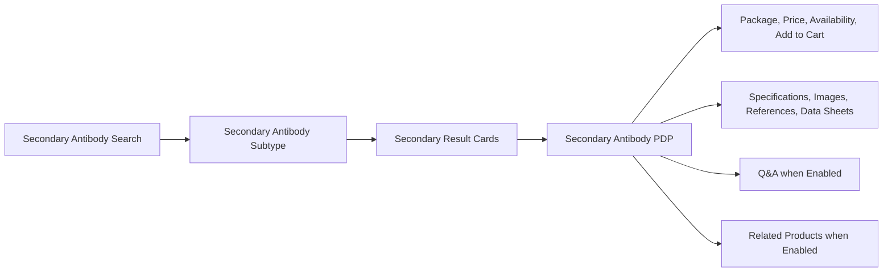

### Secondary Antibody Data Flow

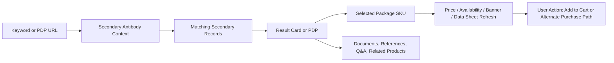

### Proteins and Peptides Functional Architecture

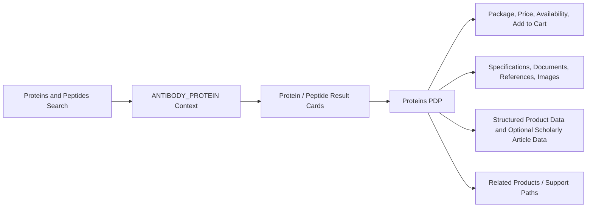

### Proteins and Peptides Data Flow

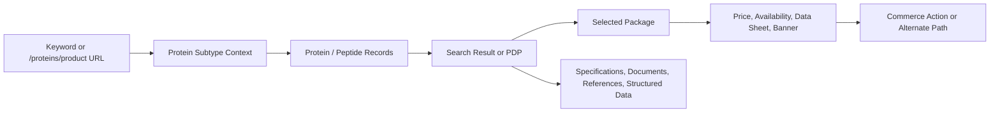

### Isotype Controls Functional Architecture

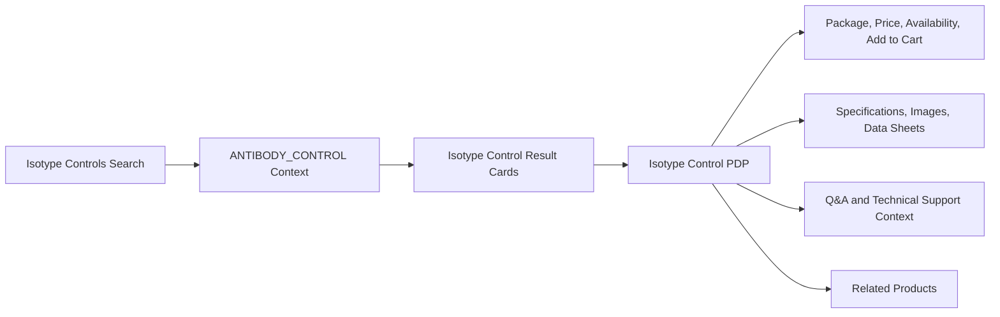

### Isotype Controls Data Flow

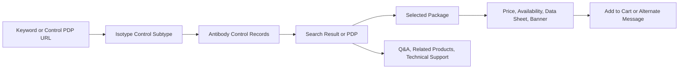

### ELISA Kits Functional Architecture

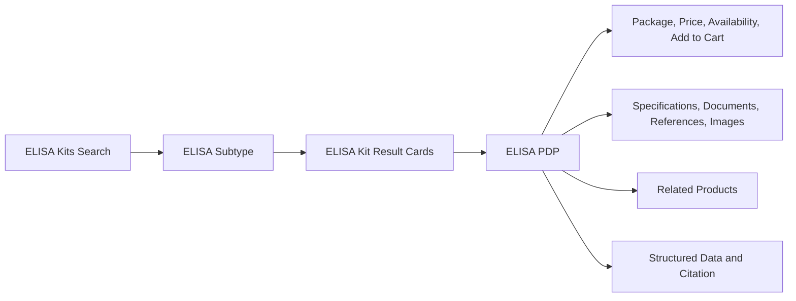

### ELISA Kits Data Flow

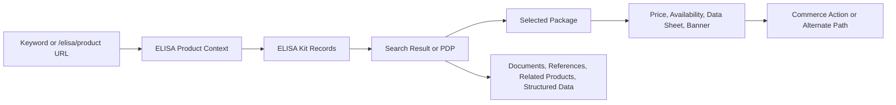

### Dependencies

- Product subtype classification and route configuration.
- Search index and search-result data quality.
- Typeahead and suggestion configuration.
- Solr re-query and keep-my-filters subtype configuration.
- Package-level catalog, SKU/web ID, entitlement, orderability, lifecycle, lead-time, and parent-SKU data.
- Pricing API eligibility, batching configuration, country eligibility, and response quality.
- Availability eligibility by country, SKU, quantity, login state, and dealer context where applicable.
- Data sheet and document availability by selected package.
- Product images and default/no-image placeholder configuration.
- Related-product enablement and source data.
- Q&A enablement and keyword/filter data.
- Analytics event capture by product subtype and user action.

## 4. APIs and Integration Capabilities

The rules documents identify capabilities and routes, but they do not provide complete API endpoint contracts for every module. The table below therefore lists only evidenced or directly required API/integration capabilities.

| Capability | Applies To | Business Requirement |
|---|---|---|
| Product-family query routes | All search families | Keyword searches must route to the product-family path: `/antibody/primary/query/{keyword}`, secondary antibody query path, `/proteins/query/{keyword}`, `/antibody/control/query/{keyword}`, and `/elisa/query/{keyword}`. |
| Product PDP routes | Proteins and Peptides, ELISA, antibody PDP families | Product cards must route to their family PDP routes, including `/proteins/product/...` and `/elisa/product/...`; antibody PDP routes must retain correct subtype context. |
| Typeahead URL / suggestions | Primary, Secondary legacy, Proteins and Peptides, ELISA; not Isotype unless configured | Typeahead must pass the correct subtype where configured; Isotype Controls must not call a product-area-specific typeahead endpoint when no typeahead URL is configured. |
| Search/filter response | All search families | Search responses must return subtype-restricted results, result counts, current filter facets, selected filters, and zero-result states without stale product cards. |
| Solr re-query behavior | Enabled subtypes only | Re-query behavior must apply only when the subtype appears in the enabled-subtype configuration. |
| Pricing API | PDP commerce families | Pricing lookup must call the configured pricing API only for eligible products and countries, must respect SKU batch limits, and must clear stale prices on failure or missing data. |
| Availability lookup | PDP commerce families | Availability must be shown only when availability is enabled for the current context and selected package/SKU is eligible. |
| Add to Cart integration | PDP commerce families | Add to Cart must submit only when the selected SKU is orderable and not long-term unavailable or discontinued. |
| Data sheet / document retrieval | PDP commerce families | Data sheet or document context must refresh when selected catalog package changes. |
| Image gallery / structured data | PDP families | Structured data must use available image or configured default/no-image placeholder and must omit invalid offer data. |
| Related products | Primary, Secondary when enabled, Isotype, Proteins/Peptides, ELISA | Related-product modules must receive the correct subtype and render only when related-product data is available and enabled. |
| Q&A | Primary, Secondary when enabled, Isotype | Q&A must use subtype-specific enablement and fail safely with zero/empty results when unavailable. |
| Analytics | All families | Analytics context must receive the correct product subtype and business action state. |

## 5. Similarities Across Product Subtypes

| Similarity | Applies To | Requirement |
|---|---|---|
| Product subtype drives behavior | All | Search, PDP modules, commerce, documents, image gallery, related products, Q&A, technical support, and analytics must receive the correct subtype context. |
| Search result restriction | All search families | Results must be limited to the selected product family/subtype. |
| Keyword limit | All search families with explicit rule | Keyword input must honor the configured 250-character limit. |
| Wildcard browse | ELISA, Isotype, Proteins and Peptides, and antibody search defaults | `*` behaves as a browse request/default keyword, not as a literal catalog-number search. |
| Current-result filters | All search families | Filters must come from the current result set, counts must update, and selected filters must be removable. |
| Zero-result safety | Search families | Zero-result handling must show the configured message and must not show stale cards from previous searches. |
| Package-based commerce | PDP families | The selected package drives catalog number, package size, web ID/SKU, price, availability, data sheet, and banner context. |
| Lifecycle gating | PDP families | Long-term unavailable and discontinued products must not expose the normal purchase path. |
| Pricing fallback | PDP families | Pricing failures or missing prices must show configured fallback messaging and must not leave stale prices visible. |
| Quantity validation | PDP families | Invalid quantities must trigger validation messaging and must not be submitted. |
| Structured offer omission | PDP families | Offer data must be omitted when the product is discontinued, long-term unavailable, not orderable, missing final price, or missing availability. |
| Analytics context | All | Search, PDP, commerce, related-products, Q&A, and content actions must be reported with product subtype context. |

## 6. Differences Across Product Subtypes

| Area | Primary Antibody | Secondary Antibody | Proteins and Peptides | Isotype Controls | ELISA Kits |
|---|---|---|---|---|---|
| Search entry | Antibody search using primary target type | Antibody search using secondary target type | Popular Product Area: Proteins and Peptides | Popular Product Area: Isotype Controls | Popular Product Area: ELISA Kits |
| Route | Primary antibody query page for keyword | Secondary antibody query path | `/proteins/query/{keyword}` | `/antibody/control/query/{keyword}` | `/elisa/query/{keyword}` |
| Result page size | Configured per subtype and environment | Configured per subtype and environment | Configured per subtype and environment | Configured per subtype and environment | Configured per subtype and environment |
| Typeahead | Limited to antibody products and primary filter; max 15 suggestions | Legacy typeahead filters to antibody products and secondary filter; max 15 suggestions | Uses configured Proteins and Peptides typeahead URL and PRANT-filtered suggestion source | No product-area-specific typeahead unless configured | Uses configured ELISA typeahead URL and passes ELISA subtype |
| Core filters | Configured primary antibody filters, including New when enabled | Configured secondary antibody filters | Protein Name, Species, Expression System, Product Type, Application, Product Grade, Tag, New, Activity, Promotion | Host, Clonality/Class, Conjugate, Application, Format, Target Class, Recombinant | Protein Target, Species, Kit Format, Research Area, Sample Type, Instrument, High Sensitivity, New |
| PDP route | Antibody product PDP with primary subtype | Antibody product PDP with secondary subtype | `/proteins/product/...` | Antibody product PDP with antibody_control subtype | `/elisa/product/...` |
| Special content | Bioinformatics, Target Information, References, Q&A, related product matching rules | Alexa Fluor Plus package banner example; Q&A/related products only when enabled | Protein category/subtype, optional scholarly article structured data | Isotype Control category, Q&A/technical support context | ELISA Kits category, immunoassay product type, documents/references/related products |
| Sample package examples from rules | Package options vary by product | A32723TR and A32723 | 10 ug, 50 ug, 100 ug, 250 ug, 500 ug, 1 mg | 50 µg, 100 µg, 500 µg | 96 Tests and 5 x 96 Tests |

## 7. Core Features and Requirements

### Shared Search Workflow

| ID | Requirement | Acceptance Criteria |
|---|---|---|
| SRCH-001 | User must enter or select a keyword for product-family search, except where wildcard browse/default keyword is used. | Search submits only when allowed by that family’s search rules and routes to the correct product-family query page. |
| SRCH-002 | Search must use the selected product subtype context. | Results, filters, Q&A enablement, related-products behavior, commerce calls, metadata, and analytics do not use another subtype. |
| SRCH-003 | Search results must be restricted to the selected product family. | Primary returns only primary antibodies; secondary returns only secondary antibodies; Proteins and Peptides returns only protein/peptide products; Isotype returns only antibody control products; ELISA returns only ELISA kit products. |
| SRCH-004 | Filters must reflect current results. | Facet counts update after filters are applied or removed, and selected filters are visible and removable. |
| SRCH-005 | Zero-result behavior must be safe. | Configured zero-result messaging appears and stale product cards from prior searches are not displayed. |
| SRCH-006 | Sort-by-price must be region-controlled. | Sort by price is available only in configured countries. |
| SRCH-007 | Promotional ads must be subtype-controlled. | Promotional ads appear only when enabled for the product subtype. |

### Product-Family Search Requirements

| Product Family | Requirements |
|---|---|
| Primary Antibody | Search uses the primary antibody target type; typeahead is limited to antibody products and primary filter; typeahead returns no more than 15 suggestions; duplicate suggestions are shown once; trademark marker is removed before search; default sort is Relevance; result count/page size are driven by active subtype configuration; newer filters and newer typeahead apply only when primary antibody is enabled in the relevant subtype list. |
| Secondary Antibody | Search uses secondary antibody target type and secondary query path; legacy typeahead filters to antibody products and secondary filter; typeahead returns no more than 15 suggestions; suggested searches include Qdot 585, Alexa Fluor 594, and HRP; default sort is Relevance; result count/page size are driven by active subtype configuration; newer filters apply only when enabled; newer typeahead is not enabled unless the subtype is configured. |
| Proteins and Peptides | Search entry is Proteins and Peptides; route is `/proteins/query/{keyword}`; page size is driven by active subtype configuration; wildcard is browse; typeahead uses configured protein/peptide suggestion source; new typeahead and spell-check do not apply unless `ANTIBODY_PROTEIN` is configured; filters may include Protein Name, Species, Expression System, Product Type, Application, Product Grade, Tag, New, Activity, and Promotion. |
| Isotype Controls | Search entry is Isotype Controls; route is `/antibody/control/query/{keyword}`; page size is driven by active subtype configuration; wildcard is browse; product-area-specific typeahead must not be called when no typeahead URL is configured; filters may include Host, Clonality/Class, Conjugate, Application, Format, Target Class, Recombinant; conjugate filters group child conjugates under configured parent families when those families have results. |
| ELISA Kits | Search entry is ELISA Kits; route is `/elisa/query/{keyword}`; page size is driven by active subtype configuration; wildcard is browse; typeahead passes ELISA subtype; new typeahead and spell-check may apply because ELISA is enabled; filters may include Protein Target, Species, Kit Format, Research Area, Sample Type, Instrument, High Sensitivity, and New. |

### Shared PDP and Commerce Workflow

| ID | Requirement | Acceptance Criteria |
|---|---|---|
| PDP-001 | PDP must render product title from display name and selected catalog number from selected package. | Product title and selected catalog number update from product/package data. |
| PDP-002 | PDP modules must receive the correct subtype. | Commerce, data sheets, image gallery, references, related products, documents, structured data, Q&A, technical support, and analytics use family-specific subtype context. |
| PDP-003 | Multi-package products must allow package selection. | Selected package updates product size, SKU/web ID, pricing, availability, data-sheet link, and banner context. |
| PDP-004 | Product title banner must evaluate lifecycle and product-specific message states. | Long-term unavailable, discontinued, replacement, and product/package banner messages display when conditions exist. |
| PDP-005 | Closing a dismissible banner must not change orderability. | Banner visibility changes only; product lifecycle, orderability, and purchase behavior remain unchanged. |
| PDP-006 | Pricing must be package-based. | Valid pricing populates price, user price, currency, and visibility for the selected package. |
| PDP-007 | Pricing failures must clear stale price. | Fallback price prompt or unavailable-price message appears and old prices are not retained. |
| PDP-008 | Normal Add to Cart must be lifecycle- and orderability-gated. | Add to Cart appears only when selected SKU is orderable and not long-term unavailable or discontinued. |
| PDP-009 | Supplier/dealer commerce paths must replace normal Add to Cart when applicable. | Learn Where to Buy or dealer-specific path is shown instead of normal Add to Cart. |
| PDP-010 | Structured offer data must be omitted when invalid. | Discontinued, long-term unavailable, not orderable, missing final price, or missing availability states suppress offer data. |

### Product-Family PDP Requirements

| Product Family | Requirements |
|---|---|
| Primary Antibody | Product records are primary antibody records with search status 1; package banners update when package changes; pricing can remove child package SKUs with specific pricing error messages while retaining parent SKU for rendering; Add to Cart quantity is constrained from 1 to 9,999; Aspire link applies only when antibody type/subtype and US/Canada country rules match; Bioinformatics, Target Information, References, Related Products, and Q&A have family-specific display and matching rules. |
| Secondary Antibody | Product records load as secondary antibody records only when the source row type is Secondary Antibody; generated product documents and data sheets use secondary antibody subtype; Q&A applies only when secondary subtype is enabled; related products apply only when secondary subtype is enabled; secondary example package banner promotes Alexa Fluor Plus and provides a Learn more link. |
| Proteins and Peptides | PDP identifies product category as Protein, product subtype as Protein, and downstream subtype as `antibody_protein`; PDP route uses `/proteins/product/...`; product-level scholarly article structured data may be generated when enabled for `ANTIBODY_PROTEIN`; sample package options include 10 ug, 50 ug, 100 ug, 250 ug, 500 ug, and 1 mg. |
| Isotype Controls | PDP identifies product as antibody product subtype `antibody_control` / Isotype Control; breadcrumbs keep product in Isotype Controls category when data is available; citation includes RRID when available; sample package options are 50 µg, 100 µg, and 500 µg. |
| ELISA Kits | PDP identifies product category as ELISA, product type as immunoassay, and subtype as ELISA; route uses `/elisa/product/...`; breadcrumbs keep product in ELISA Kits category when available; sample package options are 96 Tests and 5 x 96 Tests; sample product displays a product-specific banner promoting another ProQuantum immunoassay kit. |

### Scientific Content and Related Modules

| ID | Requirement | Acceptance Criteria |
|---|---|---|
| CNT-001 | Specifications must display only when values exist. | Empty specification values are not presented as real product content. |
| CNT-002 | Product images must use configured fallback behavior. | Structured data and PDP image modules use product images where available and configured default/no-image placeholders where permitted. |
| CNT-003 | References must load and sort when present. | Reference cards and publication tables follow product-family rules for display, sorting, and expand/collapse behavior. |
| CNT-004 | Bioinformatics and Target Information must appear only when visible content exists. | Section navigation includes these sections only when data is visible. |
| CNT-005 | Q&A must fail safely. | Q&A failures return zero counts or empty result sets rather than breaking PDP. |
| CNT-006 | Related products must follow subtype enablement and matching rules. | Related products display only when enabled and when related data exists for the selected product/subtype. |

## 8. Data and Analytics

### KPIs

| KPI | Definition | Business Use |
|---|---|---|
| Search volume by product family | Searches by Primary, Secondary, Proteins and Peptides, Isotype Controls, and ELISA Kits. | Understand demand by portfolio. |
| Search-to-result rate | Percentage of searches returning at least one product. | Measure search and catalog coverage quality. |
| Zero-result rate | Percentage of searches returning no products. | Identify synonym gaps, product gaps, or misrouted searches. |
| Filter usage | Filter applies/removes by family and facet. | Understand how users narrow product choices. |
| Product card click-through | Result clicks to PDP. | Measure product discovery effectiveness. |
| PDP engagement | Views of specifications, references, Bioinformatics, Target Information, documents, Q&A, and related products. | Identify content value and content gaps. |
| Package-change rate | Package selector changes by product family. | Identify where package choice affects decision-making. |
| Price visibility rate | Valid price, user price, fallback prompt, or unavailable-price states. | Track commerce friction. |
| Availability engagement | Availability checks, stock states, estimates, and pending estimate display. | Track purchase confidence and stock concerns. |
| Add-to-cart rate | Orderable PDP sessions that add selected SKU to cart. | Measure conversion. |
| Related-product click-through | Impressions and clicks for related-product modules. | Measure recommendation usefulness. |
| Q&A usage | Q&A counts, searches, filters, result clicks, and empty/error states. | Measure support self-service value. |
| Error rate by module | Search, typeahead, pricing, availability, cart, documents, images, related products, Q&A. | Prioritize operational fixes. |

### Reporting Events

- Product family selected.
- Keyword searched.
- Wildcard browse submitted.
- Typeahead suggestion shown and selected.
- Search results loaded.
- Zero-result message shown.
- Filter applied and removed.
- Sort changed.
- Product card clicked.
- PDP opened.
- Package changed.
- Product banner shown, closed, or replacement clicked.
- Price lookup succeeded, failed, or returned unavailable state.
- Check price or check price/availability clicked.
- Availability requested and shown.
- Quantity changed and invalid quantity message shown.
- Add to Cart clicked, succeeded, or failed.
- Supplier/dealer purchase path clicked.
- Data sheet or document opened.
- Image gallery opened.
- Specifications viewed.
- Bioinformatics viewed.
- Target Information expanded or collapsed.
- References loaded, sorted, expanded, or collapsed.
- Related product shown and clicked.
- Q&A count loaded, search performed, filter applied, result opened, or error state returned.

### Reporting Dimensions

Product family, product subtype, keyword, route, selected filters, sort option, result count, catalog number, selected SKU/web ID, selected package size, lifecycle state, price state, availability state, country, login state, product target, host, class/isotype, conjugate, application, kit format, expression system, sample type, Q&A state, related-product type, and cart outcome.

## 9. Risks and Constraints

| Risk / Constraint | Impact | Mitigation |
|---|---|---|
| Exact team repository membership is not exposed from the team URL in this environment. | PRD may miss a repository if it is outside the accessible Magellan repository set. | Confirm the authoritative `de-magellan` repository list and map each PRD requirement to source files/services before final sign-off. |
| Product subtype mapping drifts across modules. | Wrong filters, routes, Q&A, related products, commerce behavior, or analytics may appear. | Maintain subtype mapping tests and product-owner review. |
| Search index or product data is stale. | Results, counts, filters, and product cards may be incorrect. | Monitor index freshness and result-count anomalies. |
| Typeahead enablement differs by subtype. | Users may expect suggestions where product-area typeahead is not enabled. | Make subtype typeahead behavior explicit in support documentation. |
| Pricing API returns missing or failing data. | Users may see fallback prompts or cannot confidently purchase. | Track pricing failures and clear stale price values. |
| Availability rules depend on country, SKU, login, and configuration. | Support teams may not reproduce customer availability states. | Capture country, login state, selected SKU, and availability response in support diagnostics. |
| Package changes fail to refresh dependent context. | Price, availability, banner, or data sheet may refer to the wrong SKU. | Add regression tests for package-change refresh. |
| Related-product matching data is incomplete. | Recommendations may be missing or weak. | Review related-product quality by subtype and track click-through. |
| Q&A enablement differs by subtype. | Users may see Q&A for some product families and not others. | Document Q&A-enabled subtype rules and monitor empty/error states. |
| Compliance-sensitive messages are missing or stale. | Research-use, diagnostic-use, resale, discontinued, or replacement messaging risk. | Include compliance review in release readiness. |

## 10. Operations and Support

### Monitoring

- Search latency and error rate by product family.
- Typeahead/suggestion latency and error rate by product family.
- Result-count anomalies and zero-result spikes.
- Filter/facet failures and selected-filter state errors.
- PDP load success and section visibility by subtype.
- Pricing API success, failure, fallback, and batch-limit behavior.
- Availability lookup success, estimate/pending states, and region-specific behavior.
- Add to Cart success and failure by SKU/web ID and product family.
- Package-change refresh failures.
- Banner display frequency by lifecycle state.
- Document/data sheet link failures.
- Image/default image failures.
- Related-product empty/error response rate and click-through.
- Q&A count/search failure and empty-result rates.
- Analytics event completeness by product subtype.

### Incident Scenarios

| Incident | Business Impact | Support Response |
|---|---|---|
| Search route returns wrong product family. | User may evaluate incorrect products. | Validate route, subtype context, and selected search entry. |
| Filters disappear or counts are wrong. | User cannot narrow results confidently. | Check current result set, enabled filter configuration, and re-query behavior. |
| Price is missing or stale. | User cannot assess purchase cost. | Check eligibility, country, selected SKU, pricing response, and fallback state. |
| Add to Cart is not available. | User cannot purchase. | Check orderability, lifecycle state, quantity, selected SKU, pricing action, and supplier/dealer path. |
| Availability shows Pending or missing. | User cannot assess delivery timing. | Check availability eligibility, selected SKU, quantity, country, and estimate state. |
| Related products are missing. | User may miss required controls, kits, or alternatives. | Check subtype enablement and related-product data. |
| Q&A is empty or unavailable. | User may require support escalation. | Check Q&A enablement, SKU match, keyword filters, and service status. |
| Product banner conflicts with purchase action. | User may misunderstand availability or replacement status. | Check selected package lifecycle and banner source. |

### Common Support Needs

- Explain which search entry to use for each product family.
- Explain why typeahead exists for some families and not others.
- Explain why a product appears or does not appear in a filtered result set.
- Explain wildcard browse behavior.
- Confirm selected SKU/web ID and package size.
- Explain price prompt, no-price, View price in cart, Contact Us, Learn Where to Buy, or dealer-specific paths.
- Confirm product lifecycle state and replacement messaging.
- Confirm why related products or Q&A appear or do not appear.
- Help users refine searches when zero results appear.

## 11. Acceptance Criteria

| ID | Scenario | Expected Result |
|---|---|---|
| AC-001 | Submit a keyword search for each family. | Search routes to the correct product-family page and returns only that family’s products. |
| AC-002 | Submit `*` for ELISA, Isotype Controls, and Proteins and Peptides. | Wildcard browse returns product-family coverage rather than treating `*` as a literal catalog number. |
| AC-003 | Use typeahead where configured. | Suggestions are subtype-appropriate; duplicate suggestions are shown once where specified. |
| AC-004 | Apply and remove filters. | Filter counts, selected filters, and result counts update to match the current result set. |
| AC-005 | Search with no matching products. | Zero-result message appears and prior product cards are not shown. |
| AC-006 | Open a multi-package PDP. | Package selector appears and package change refreshes SKU/web ID, price, availability, data sheet, and banner context. |
| AC-007 | Open a long-term unavailable product. | Normal Add to Cart is not shown and configured alternate/contact behavior appears. |
| AC-008 | Open a discontinued product. | Normal Add to Cart is not shown and discontinued messaging appears. |
| AC-009 | Pricing fails or returns missing data. | Stale prices are cleared and fallback prompt/unavailable message appears. |
| AC-010 | Enter invalid quantity. | Validation message appears and invalid quantity is not submitted. |
| AC-011 | Open a primary antibody with Bioinformatics. | Protein aliases, gene aliases, UniProt ID, Entrez Gene ID, Function(s), and Process(es) appear when data exists. |
| AC-012 | Open References on a primary antibody with references. | Reference cards load and sorting/expand-collapse behavior works according to rules. |
| AC-013 | Open Q&A where enabled. | Q&A count and result behavior follow subtype rules; failures return safe zero/empty states. |
| AC-014 | Open related products where enabled and data exists. | Related products display only for eligible subtype/data combinations. |
| AC-015 | Open ELISA PDP. | Product category is ELISA, product type is immunoassay, route is `/elisa/product/...`, and selected package drives commerce behavior. |
| AC-016 | Open Proteins and Peptides PDP. | Product category/subtype is Protein, route is `/proteins/product/...`, and selected package drives commerce behavior. |

## 12. Release Readiness Checklist

| Area | Readiness Requirement |
|---|---|
| Repository traceability | Confirm the authoritative `de-magellan` repository list and map requirements to source repositories. |
| Rule coverage | Confirm every source rule document in the NoTaqMan ZIP is represented. |
| Search routing | Validate Primary, Secondary, Proteins and Peptides, Isotype Controls, and ELISA routes. |
| Search filters | Product-owner sign-off on filter labels, order, counts, empty/disabled filters, and selected-filter behavior. |
| Typeahead | Validate enabled and disabled subtype behavior. |
| PDP identity | Validate product type, subtype, title, catalog number, route, breadcrumb/category, and citation. |
| Commerce | Validate selected package, SKU/web ID, pricing, availability, quantity, Add to Cart, and alternate purchase paths. |
| Lifecycle banners | Validate long-term unavailable, discontinued, replacement, and product-specific banner behavior. |
| Structured data | Validate non-empty specifications, images/default images, and offer omission rules. |
| Content modules | Validate documents, images, references, Bioinformatics, Target Information, related products, and Q&A where applicable. |
| Analytics | Validate required reporting events and dimensions end to end. |
| Operations | Confirm dashboards and alerts by product family and module. |
| Support | Publish support playbook for routing, search, pricing, availability, lifecycle, Q&A, and related-products issues. |
| Compliance | Review research-use, diagnostic-use, resale, lifecycle, and product-specific banner messaging. |

## 13. Open Questions

- Who is the named business owner for each product family?
- Which exact repositories are authoritative for search UI, PDP UI, product data, pricing, availability, cart, Q&A, related products, documents, images, and analytics?
- Should this PRD remain a single parent PRD, or should each product family have a child PRD?
- Which product families should support compare, export, or email in future scope?
- What are the target SLAs for search, typeahead, pricing, availability, documents, related products, and Q&A?
- What analytics platform is the source of truth for reporting events?
- Should support users have a diagnostic view showing subtype, route, selected SKU/web ID, package size, country, login state, price action, availability result, Q&A enablement, and related-product state?

## 14. Source Rule Documents Used

| Rule Document From ZIP | Scope Used |
|---|---|
| `Primary_Antibody_Search_Business_Rules_Copy.docx` | Primary antibody search, typeahead, default searches, filters, sort, wildcard/default behavior, result count, and search constraints. |
| `Primary_Antibody_Product_Series_Business_Rules.docx` | Primary antibody PDP, commerce, price, availability, specifications, images, Bioinformatics, Target Information, References, Related Products, and Q&A. |
| `Secondary_Antibody_Search_Business_Rules.docx` | Secondary antibody search, legacy typeahead, result limits, filters, sort, and subtype enablement. |
| `Secondary_Antibody_Product_Series_Business_Rules.docx` | Secondary antibody PDP, classification, banners, commerce, price, availability, Q&A enablement, related-products enablement, and documents/data sheets. |
| `Proteins_Peptides_Search_Business_Rules.docx` | Proteins and Peptides search entry, route, page size, typeahead, filters, metadata, image search exclusion, sort, and promotions. |
| `Proteins_Peptides_Product_Series_Business_Rules.docx` | Protein/peptide PDP identity, route, commerce, package examples, structured data, documents, references, and scholarly article structured data. |
| `Isotype_Controls_Search_Business_Rules.docx` | Isotype Controls search entry, route, page size, typeahead constraints, filters, conjugate grouping, selected filters, zero-result handling, sort, badges, and promotions. |
| `Isotype_Controls_Product_Series_Business_Rules.docx` | Isotype Control PDP identity, commerce, packages, structured data, banner behavior, Q&A, related products, technical support, and analytics. |
| `ELISA_Search_Business_Rules.docx` | ELISA search entry, route, page size, typeahead, filters, metadata, image search exclusion, sort, promotions, and zero-result behavior. |
| `ELISA_Product_Series_Business_Rules.docx` | ELISA PDP identity, route, commerce, package examples, structured data, banner behavior, references, related products, documents, and analytics. |

## 15. Repository Validation Note

The user requested review of the de-magellan team repositories. The exact team repository membership list is not exposed from the team URL in this environment, so the PRD is grounded in the supplied no-TaqMan rule documents, uploaded PRD templates, and accessible Magellan repository evidence. Final sign-off should confirm the authoritative team repository list and map each requirement to source-owned files or services.
